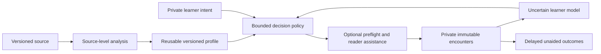

# Nabu: authentic media, conditional understanding, and trajectories

**Implementation and research handoff | 18 November 2026 | baseline Nabu 1.18.0**

Status legend: **Verified repo** = inspected contents of `hasan1s7/NA` at main commit `c624841475dfd584d231bf355d40d7b06cc83f7a`; **Tested local** = tested the separate delivery package, not the production app; **Proposed** = a design or unvalidated hypothesis. No external learner data were used.

## 1. The thesis, starting with a learner

A new Spanish learner opens a poem:

> En la mesa hay una llave. En la mesa hay una flor. En la mesa hay un libro.

The same written opening recurs while the final noun changes. Nabu can identify this **before any lookup**, without knowing anything private about the learner. It can offer a small optional note: "This wording occurs three times with changing endings." The learner then reads, chooses *hay*, obtains contextual help, saves its source-linked occurrence, returns later, and attempts a meaning question without the visible answer. A later unfamiliar sentence can investigate transfer. Each success claim is restricted to the exact task and support conditions.

This requires three independent layers, not one catch-all difficulty score: (1) **source analysis**, which can be reusable; (2) **learner evidence**, which is private, assistance-conditioned, uncertain, and never generated by a preview; and (3) **decision policy**, which compares activities relative to the learner's revisable intention. The predictive model asks what a learner may do; the causal model asks whether choosing an activity improves a later outcome. Those are different questions.

The first product must remain a good reader without a quiz. Preflight is a disclosure, not a gate.

## 2. Repository audit: what actually exists

Inspected in the connected GitHub repository, default branch `main`, package version 1.18.0. Repo branch search did not verify a separate 1.19 branch. The repository's own documentation describes six curated Arabic content pieces; the front end also supports user-supplied text in all 12 registry languages. These are not synonymous with uniformly validated linguistic analysis.

| Capability | Inspection finding | Assessment for B1/B2 |
| --- | --- | --- |
| Reader and source anchors | `public/nabu-content.js` maintains versioned curated items, annotated Unicode-scalar offsets, `anchoredTokens`, and corpus validation. `public/nabu-explore-ui.js` renders and resumes them. Own-text reading lives in `public/nabu-app.js`. | **B1 curated: present**; own-text versioned identity still narrower. |
| Contextual assistance | Authored curated annotations open existing word-support panel; ordinary reader invokes bank/provider fallback. Draft authoring is labeled. | **Present, quality-dependent**. Contextual analysis is not universally verified. |
| Save and return | Curated annotation saving reuses the existing card store and attaches progress (`saved` with annotation/card ID); content progress preserves position and events. | **Present for supported curated paths**; robust return identity on arbitrary imported media remains a later integration. |
| Valid activity | `nabu-content.js` holds task types and answer policies; `nabu-explore-ui.js` captures hint/answer visibility and persists responses. Existing moment/support-cycle tasks also exist. | **Present only for bounded authored tasks**, not every arbitrary phrase. |
| Learner evidence | `nabu-observations.js`, `nabu-support-cycle.js`, `nabu-learner-*` distinguish exposures, hints and submitted answers with bounded inferences. | **Reuse.** Do not infer mastery from preflight. |
| Intent and choice | `nabu-intents.js`, `nabu-next-step.js` and policies capture revisable goals and provide transparent heuristics. | **Reuse;** no demonstrated personalized causal optimization yet. |
| Graph | `nabu-graph-*` and structure modules preserve typed relations, some ambiguity and authored witnesses. | **Not a universal morphological/sense parser.** Do not populate evidence from graph edges. |
| Media pre-analysis | No verified general reusable preflight profile linked to the reader was found in the inspected modules. | **Locally implemented new surface-only slice**, pending full integration. |
| Deployment | `tools/build_standalone.py` inlines modules into a generated HTML page; `tools/build_pages.py` copies a Pages shell to the root of `main`. | Source-only feature branch and explicit rebuilding necessary. |

**Constraints from repo:** `AGENTS.md` explicitly requires coverage of the twelve codes in `public/nabu-core.js`: `en`, `ar`, `zh-CN`, `fr`, `ru`, `es`, `de`, `it`, `ja`, `ko`, `pt`, `tr`; preserving data and separating direct evidence from inference. The new module invokes `isLanguage()` from this registry. Tests iterate every registered code instead of asserting a manually assumed count.

**Access boundary:** GitHub connector could read source but returned HTTP 403 on creating an isolated branch. No push, PR, merge or deployment occurred. The local delivery therefore includes an additive, fail-closed branch-only installer rather than replacing a production file. The full repository was not downloadable into this execution environment; full Nabu regression and real in-app browser tests were **not** run.

## 3. Six foundational objects and persistence contracts

### Source

The authoritative original media object. Key fields: `sourceId`, immutable `sourceVersion`, provenance/licence, language/variety, media type, title, source segments, transcript/alignment, publication context, content fingerprint, and analysis status. For user-owned text, no fabricated global source ID: the delivered local profile explicitly reports `id:null`, `version:null`, and `local-unversioned`. A durable source ID/version and strong fingerprint are **future work** for own-text imports. Media sources and private accounts must not be conflated.

### Linguistic occurrence

An anchored selection of one or more spans in a specific source version: `sourceId`, `sourceVersion`, `segmentId`, `startScalar`, `endScalar`, `surfaceQuote`, `anchorFingerprint`, language and candidate concept references. The same construction in two documents produces two occurrences. A discontinuous form needs multiple spans, not a fabricated contiguous substring. The present local profile validates simple curated annotations against their original Unicode-scalar span; any invalid anchor is rejected and reported, not quietly re-aligned.

### Linguistic analysis

A versioned claim about an occurrence: analysis type (surface, morphology, syntax, semantics, pragmatics), competing hypotheses, evidence, provenance, reviewer status, confidence or abstention. **Source observations are not proficiency estimates.** The delivered code only produces `exact-surface` recurrence and `exact-surface-frame` repeated n-grams. Its `semanticParsing` field always says `not-attempted`. Example: repeated *hay* spelling is not evidence of a shared sense in all contexts.

### Learning task

An authored or validated assessment opportunity: task ID/version, source occurrence and target, input/output modalities, allowed supports, prompt, accepted responses or verified rubric, analysis fingerprint, scoring/abstention policy, uncertainty, and reviewer provenance. A free-form exercise without trustworthy scoring remains unscored. A superficially similar task is not proof of equivalent competence.

### Learner encounter

An immutable, scoped fact about interaction: learner ID, organization boundary (if any), event ID, episode and attempt IDs, source/occurrence/version, action (`opened`, `lookup`, `save`, `answer`, `skip`, `return`, etc.), first response, assistance actually available, latency/time, rubric/version, and retries. Deduplication must preserve first response and reject inconsistent duplicate identities. A viewed answer cannot be converted into an independent correct result after the fact.

### Learner trajectory

The learner's revisable actor, immediate activity, optional destination, target language/modality, constraints, confidence and provenance. Example: "Read a short Spanish poem now" with a longer goal of "converse with Spanish-speaking relatives". These two intentions may suggest different content, but neither creates inferred knowledge. The learner can reject a recommendation or read a difficult text anyway.

**Storage boundaries:** The server may cache source-level profiles keyed by source ID, source version, profile-schema version and analysis version; a learner-conditioned recommendation should be recomputed under the current private learner/intent revision. Never cache a learner posterior into a publicly reused source profile. Keep original event records authoritative and versioned, preserve current account/tenant scoping and offline outbox identities, and do not replace existing review schedules. Those contracts are **proposed design specifications**, not new database functionality in this delivery.

**Minimal representative records (proposed schema):**

```json
{
  "source": {"id": "poem-47", "version": 3, "language": "es", "rights": "original", "fingerprint": "sha256:<calculated-at-ingestion>"},
  "occurrence": {"sourceId": "poem-47", "version": 3, "segmentId": "s2", "startScalar": 0, "endScalar": 18, "quote": "En la mesa hay una"},
  "analysis": {"version": "surface-preflight-v1", "kind": "exact-surface-frame", "confidence": null, "semanticStatus": "not-attempted", "provenance": "deterministic segmenter"},
  "task": {"id": "task-37", "version": 1, "dimension": "meaning-recall", "modality": "written", "scorerStatus": "human-reviewed", "baseAssistance": []},
  "encounter": {"eventId": "uuid", "actorId": "private-user", "sourceVersion": 3, "kind": "submitted-answer", "assistance": {"answerVisible": false}, "firstResponseLocked": true},
  "trajectory": {"actorId": "private-user", "revision": 7, "immediateActivity": "read", "destination": "discuss poetry", "intentStatus": "explicit"}
}
```

The placeholder `sha256:<calculated-at-ingestion>` illustrates a future ingestion contract; the shipped profiler does **not** compute SHA-256.

### Data-flow diagram



The arrow from UI back to encounters represents **actual observed actions**, not automatic credit for previewing a preflight. `O` must be acquired by valid tasks under controlled conditions.

## 4. Delivered media-analysis vertical slice (what is actually coded)

**New module:** `public/nabu-media-profile.js`, with deterministic, local `analyzeMedia`, `analyzeText` and `renderPreflight` functions. The current profile contains:

- Source metadata: language, media type, title, source ID/version if genuinely supplied, number of segments, `sourceStatus`.
- Surface analysis: written-word occurrences, first occurrence within the piece, returning occurrence within the piece, and a per-segment first-form rate. `Intl.Segmenter` supplies script-aware word/sentence boundaries where supported; there is no English-space tokenizer fallback pretending to work for Chinese or Japanese.
- Exact written-form recurrence and repeated 2- to 5-token written frames; the number of distinct immediate following written forms. These are **surface facts**, not recognized grammar, morphology, sense identity or claimed teaching value.
- Validated curated annotation anchors with rejected-ID diagnostics; no silent repair.
- Quality, provenance and explicit abstention (`intl-segmenter` missing => `analysisStatus:abstained`, no fabricated frames).
- A minimal native `<details>` preview panel with one recurring pattern or a limitation note. It is optional, accessible by keyboard, responsive, and has no event-write path.

**Integration installer:** `tools/apply_media_preflight.py --check` verifies all exact source anchors without altering files. `--apply` verifies it is inside a non-default Git feature branch, adds imports to existing reader/curated components, inserts the optional panel, connects the standalone builder and appends contained CSS. Re-running the installer does not duplicate edits. If an upstream file differs, it stops rather than guessing or replacing whole files. It does not edit browser or SQLite data, review schedules, account state or deploy files.

**What is explicitly NOT coded:** a server-side media pre-processing queue, database-cached profiles, contextual or morphosyntactic parser, speech diarization/audio alignment, multilingual expert-verified analyses, user-conditioned novelty, predictive difficulty, graph-based transfer model, exercise generation, new retrieval tasks, a new learning scheduler, or causal recommendation optimization. The integrated display is calculated at reader render time in-browser: this is the first reusable **source-level computation**, not a completed scalable backend service.

**Why we did not rewrite B1:** B1's complete curated encounter-to-return path already exists in the baseline. The smallest low-risk extension is therefore a read-only B2 surface analysis wired into that experience. Arbitrary own-text saving and later verified exercise availability still depend on the existing lookup/review infrastructure; there is no claim that every pasted expression receives a valid scored exercise. Browser/device acceptance is not yet certified.

## 5. Formal novelty and recurrence: distinguish mathematical definitions from psychological constructs

For language `l`, source `x`, segment `i`, let `W_i` be the ordered surface-token sequence produced by the declared segmenter. Let `C_{<i,t}(w)` count that surface before token `t` of segment `i`. Our implemented, observable **first surface rate** is

\[
F_i(x)=\frac{\sum_{t=1}^{|W_i|}\mathbf 1[C_{<i,t}(W_{it})=0]}{|W_i|},
\]

with `null` for empty-token segments. This measures **first within piece**, not vocabulary unknown to a person. It is sensitive to inflection, punctuation, segmentation quality and source ordering; cross-document memory is not included. `W_i` is available for all registered languages only when `Intl.Segmenter` supports that locale on the runtime, not because a grammar parser exists for them.

For a surface frame `g` of width 2-5, let `R_x(g)` be its exact occurrence count and `V_x(g)` the number of distinct immediate following written forms (where the next word belongs to the same sentence/punctuation run). A transparent candidate for a **recurrence-with-variation flag** is:

\[
I_g(x)=\mathbf 1[R_x(g)\ge 2 \land V_x(g)\ge2].
\]

Our code counts `R` and `V` and ranks candidate frames; it does **not** turn the indicator into a learning-gain prediction. This is deliberately weaker than a construction identity: a fixed n-gram may straddle an idiom, be polysemous or be pedagogically useless.

For future learner-conditioned analysis, let `K_i` be verified concept/task hypotheses relevant to segment `i`; `q_{u,k,c}=P(\text{assistance required on }k\mid E_u,c)` under task/modality/support context `c`, and `w_{ik}` a grounded relevance weight. Then the **hypothetical burden index**

\[
B_i(u,c)=\sum_{k\in K_i}w_{ik}q_{u,k,c}
\]

requires posterior uncertainty bands and validated mappings. It cannot be computed honestly when `K_i` is unknown, graph links unreviewed, or the cold-start learner has no diagnostic evidence. Treat it as a design target, **not implemented** or a validated psychological measure. It also omits interactions and discourse-level bottlenecks, so adding terms independently can misstate comprehension.

### Reproducible equal-token example

Consider these two English passages, each with the **same surface vocabulary, the same token counts, and seven tokens per sentence**:

**A: stable construction with changing nouns**

> In the room there is a key. In the room there is a book. In the room there is a lamp.

**B: varied word order, same token multiset**

> There is a key in the room. In the room there is a book. A lamp is there in the room.

`analyzeText` returns identical per-segment first-form rates `[1.00, 0.14, 0.14]` for A and B, so a **bag-of-words difficulty model sees no difference**. But A has the five-token repeated frame `the room there is a` three times, with three different following nouns; B's highest-following-diversity repeated frame is only `there is a` twice. This is a synthetic computation from the delivered algorithm, not evidence that a learner would learn more from A. B's final sentence is more marked stylistically; a valid human experiment must control acceptability and discourse naturalness rather than mistaking surface variation for a causal treatment.

**Counterexamples:** More repetition can be boring; a polysemous form can repeat while switching senses; a memorized frame can conceal failure to generalize; a title may include repeated formulaic words with no instructional value; very early learners may benefit from stable context while an advanced learner may benefit from contextual diversity. Japanese sentence boundaries and Arabic clitic segmentation are platform- and analysis-dependent, not validated morphological segmentation. Audio prosody and timing are absent entirely from this first profile.

## 6. Learner inference and decision objective (proposed; not shipped)

A minimal uncertainty model should maintain evidence for at least recognition, written/auditory comprehension, meaning recall, form recall, contextual production and later transfer, conditioned on source visibility, hints, answer visibility and modality. Let `Z_{u,k,d,t}` be a latent ability for learner `u`, concept `k`, dimension `d`, time `t`, with hierarchical priors across concepts only where relations are reviewed. Response likelihood must model guess/slip/ambiguity and prompt assistance. Marginal posteriors need not be independent; retrieval might depend on recognition, so compare an independent-factor model with an explicit joint model on identical histories. In a small synthetic design, exact enumeration can benchmark approximate inference. Validate calibration before interpreting probabilities as proficiency.

Three operations remain separate:

1. **Inference:** conditioning on an observed answer updates beliefs about a possibly unchanged ability.
2. **Memory transition:** elapsed time can widen uncertainty or induce a modelled state transition under explicit assumptions.
3. **Intervention:** reading/practice might change future ability, but that is a causal parameter requiring identified outcomes.

Proposed transparent media policy (not a fitted estimator):

\[
U(x,u,g,a)=\alpha V_{\text{goal}}+\beta V_{\text{learning opportunity}}-
\gamma C_{\text{assistance}}-\delta C_{\text{time}}-\eta C_{\text{interruptions}}
\]

Each term must have a measurable operationalization, safe scale and uncertainty. Hard constraints include explicit learner choice, rights to use media, available language support, and validated task keys. Start with bounded rules and display *why this piece may fit* rather than magic learner percentages. The research target is later unaided task performance, `E[Y_delayed,unaided | do(policy), learner history]`, which cannot be estimated causally from self-selected recommendation outcomes alone.

## 7. Evidence review, including disagreement

**Frequency:** Uchihara, Webb and Yanagisawa (2019), *Language Learning*, DOI [10.1111/lang.12343](https://doi.org/10.1111/lang.12343), meta-analyzed 45 correlations from 26 studies (`N=1,918`) and found mean `r=0.34` between repetition and incidental vocabulary learning. It is a **correlational** synthesis with moderators including vocabulary knowledge, spacing, visual support and test format. It supports making recurrence visible and testable, not claiming that three exposures guarantee a learning gain.

**Glosses:** Zhang and Ma (2024 issue; first online 2021), *Language Teaching Research*, DOI [10.1177/13621688211011511](https://doi.org/10.1177/13621688211011511), evaluated 20 studies (`N=2,291`), found positive average effects for textual glosses with consequential design and measure moderators. This motivates contextual help but does not validate Nabu's particular lookup cards.

**Contextual diversity:** A 2026 systematic review/meta-analysis, DOI [10.1017/S0142716426100691](https://doi.org/10.1017/S0142716426100691), reported a pooled behavioral `d≈0.44` for diversity on word learning, alongside separate eye-tracking results and methodological restrictions. This supports testing *when* variation transfers, rather than maximizing novel nouns as an invariant rule. Check populations, naturalness, task compatibility and delayed outcomes before applying that pooled estimate to Nabu.

**Repeated exposure under controlled comparison:** He and Chen (2026), DOI [10.5539/hes.v16n4p800](https://doi.org/10.5539/hes.v16n4p800), report 21 independent comparisons (`N=1,227`), random-effects `g=0.63` with **very high heterogeneity** (`I²≈89.5%`) and a prediction interval spanning negative effects. Their assessment/modality subgroups should not be interpreted as causal mechanisms. This weakens the simplistic 'more exposures is always better' argument.

**Vocabulary coverage:** Nation (2006), *Canadian Modern Language Review*, DOI [10.3138/cmlr.63.1.59](https://doi.org/10.3138/cmlr.63.1.59), analysed English corpus-based lexical coverage and reasoned from a 98% comprehension threshold. This is a meaningful motivation for coverage analysis but *not* evidence that a learner's known-word probabilities can be inferred from a word list, nor that 98% is the unique threshold for every text, language, or purpose.

**Controlled repetition:** Webb (2007), *Applied Linguistics*, DOI [10.1093/applin/aml048](https://doi.org/10.1093/applin/aml048), compared 1, 3, 7 and 10 encounters among 121 Japanese learners of English, assessing several aspects of word knowledge. Effects varied by dimension; more exposures did not establish full mastery. Its controlled materials and response measures should not be confused with unconstrained authentic multimedia.

**Spacing and retrieval:** Kang (2016), *Policy Insights from the Behavioral and Brain Sciences*, DOI [10.1177/2372732215624708](https://doi.org/10.1177/2372732215624708), reviews evidence favoring temporally spaced practice over massed review. Carpenter (2012), *Current Directions in Psychological Science*, DOI [10.1177/0963721412452728](https://doi.org/10.1177/0963721412452728), discusses benefits and limitations in transfer from retrieval practice. Both motivate comparing later independent retrieval, but neither calibrates Nabu's retention dynamics or proves a fixed practice ladder optimal for every modality.

**Learner-state modeling:** Corbett and Anderson (1994), *User Modeling and User-Adapted Interaction*, DOI [10.1007/BF01099821](https://doi.org/10.1007/BF01099821), formulated knowledge tracing for a programming tutor's procedural rules. It is an important starting point for explicit latent-state modeling, not a direct validation of multidimensional linguistic understanding. A Nabu model must test identifiability, task scoring, conditions of assistance, transfer and dependence among recognition/recall/production.

**Research scope:** This is a **targeted, source-checked evidence review**, not a completed systematic review of every computational morphology, automatic exercise generation, knowledge tracing and adaptive recommendation paper through 2026. Language-specific parser quality, training distributions, bias, privacy and automated grading require their own reviews before those capabilities ship.

**Adversarial positions:**

- **Linguist:** Without sense disambiguation or morphology, surface recurrence can overcount meaningful sameness. The present UI explicitly states that limitation; reviewers must authorize higher-level claims.
- **Psycholinguist:** A novel word in an interesting story can matter more than a mechanically easy sequence. Goal relevance and engagement are separate outcomes.
- **Statistician:** Latent states may not be identifiable from sparse, selected practice events. Report abstention, intervals and sensitivity analyses.
- **Causal researcher:** Users choose content and help, creating confounding. Randomize policies and keep held-out delayed assessment blind to intervention whenever practical.
- **Engineer:** Immutable source IDs, account isolation, safe code paths and graceful runtime fallbacks are more important than arbitrary theoretical completeness.
- **Product designer:** Preflight should disappear into a single optional line; do not teach users Bayesian terminology.

## 8. Falsifiable experimental program

All experiments below are **proposals; no human outcomes were collected**. Pre-register the population and primary delayed outcome, count attrition, and obtain consent for storing answer data. Prefer assessed and independently reviewed source items over synthetic items for human claims. Define an intention-to-treat estimate alongside any secondary per-protocol analysis.

| Experiment | Randomized contrast | Primary outcome | Important failure mode |
| --- | --- | --- | --- |
| **A. Preflight** | Standard reader vs same reader plus optional text preview, matched content and review opportunity. | 7-day (or predeclared delay) **unaided comprehension in an unseen equivalent context**. | More clicks/lookups without improved held-out comprehension; preflight itself reveals assessed answers. |
| **B. Recurrence and variation** | Stable-frame repetitions vs distributed-context repetitions; match target types/frequency, length, topic and editorial naturalness. Stratify or interact by measured baseline ability. | Delayed transfer to new lexical fillers/contexts (blinded rubric). | A text sounds unnatural; differences reflect coherence or exposure time rather than variation. |
| **C. Goal-conditioned policy** | Existing accessibility heuristic vs same bounded heuristic plus the person's explicit goal, with opt-out in both arms. | Delayed goal-relevant communication performance with verified tasks. | User refusal or recommendation bias; assistance burden overwhelms task relevance. |
| **D. Model dependency** | Independent dimension-specific posterior vs joint posterior on **identical histories**; separately test candidate policies after calibrating models. | Log predictive score, calibration, credible-interval coverage on held-out observations. | Apparent benefit arises solely from different task selection; exact model not tractable or priors dominate. |

A conservative power illustration for a two-arm continuous-outcome experiment is `n_per_arm ≈ 2*(z_(1-alpha/2)+z_(1-beta))^2 / d^2` under equal variance, independence and no clustering, **before** attrition and multiple testing. For `d=0.30`, two-sided `alpha=.05`, power `.80`, this rough approximation yields ~175 participants per arm; it is **not** a validated sample-size calculation for Nabu. Actual design must account for expected variance, classroom clustering if present, item sampling, attrition and repeated measures.

Useful data: consented baseline language/task diagnostics, precise trial assignments, source and task versions, selected supports, delayed independent response, abstentions, rejected recommendations, reading completion, and review attempts. Protect raw user media; do not send private material to a profiling provider without explicit user authorization. Analysis plans should state handling of missing data, selection bias, treatment spillover, and correction/version histories. Never describe synthetic exactness or replay counts as a real-world learning effect.

## 9. Verification record and failure boundaries

**Tested local:** `node --test tests/media-profile.test.mjs` passes 11 isolated cases: twelve registry languages, Spanish repetition/variation, Arabic plus emoji source anchors, punctuation/segment boundary behavior, HTML escaping, invalid input, Turkish casing, empty-evidence boundary, and missing segmenter abstention. The module's source-level code was also executed in a headless Chromium **isolated component preview**. This demonstrates computation and a screenshot, **not** an integrated Nabu reader or authenticated save/review session.

**Tested local installer:** 4 safety tests cover read-only anchor validation, application twice on a controlled source fixture (idempotence), refusal on `main`/`master`/detached HEAD, and missing-source-anchor fail-closed behavior. It preserves the fixture on failed checks. These checks do not substitute for verification of the full current Nabu tree; upstream may change between inspection and installation.

**Not verified:** running `npm test` and `npm run test:dom` against the complete production checkout, rebuilding the multi-megabyte self-contained Pages app, live account/tenant paths, preserving actual user's browser storage across upgrade, full mobile responsive app, native Android/iOS, DeepL/ElevenLabs, screen-reader flow, production commit or deployment. No human linguistic review in all twelve languages. No long-term learner performance outcomes.

**Known engineering limits:** `Intl.Segmenter` differs by platform and is not a certified morphological parser. Surface frames may be redundant, cross structural boundaries or miss discontinuous constructions. Own-text preflight is local and ephemeral. A source corrected after profiling must be re-analyzed under the new version; a future cache must key by version/fingerprint. Curated annotation anchor status is detected, not auto-repaired. There is no audio/video pre-analysis. The first UI may need additional space/verbosity testing with actual users.

## 10. Roadmap with acceptance gates

**B1 — reliable encounter-to-return:** Keep existing curated path, validate actual install using one Arabic curated item and one independent response, check source reopening, help flags and account switching. Broaden stable, versioned own-text source identity only after a migration-safe design and tests. Gate: an unsupported exercise never produces a mastery outcome.

**B2 — reusable source profiling and optional preflight:** The delivered local surface module and reader insertion are the starting slice. Next add asynchronous server/cached source-level profiles keyed by source/version/analyzer; editorial review and provenance; segment + speech alignment where real; optional preflight with a single useful observation. Gate: zero unauthorized network/data writes, no false learner evidence, and verified app build/DOM/browser checks.

**B3 — learner-conditioned selection:** Join the reusable source profile with current private, versioned evidence and explicit trajectory; separate modality/task, explicit uncertainty/abstention, and bounded heuristic reasons. Gate: calibrated support predictions on held-out histories and no leakage of private learner data to shared profiles.

**B4 — validated trajectory optimization:** Compare actual randomized policies, delayed independent performance and transfer, long-term retention, support burden, choice, and differential effects by baseline level. Gate: pre-registered credible improvements that survive multiple outcomes, attrition/sensitivity checks, and external language-review audits. No universal-learning superiority claim before then.

## 11. What we still need from the workshop

The referenced workshop slides 21-23 or consolidated workshop deck were **not supplied or verified**. The repository's `Presentation-and-Previews` folder contains a Nabu 1.15 walkthrough and Bayesian learner paper, but was not verified as the referenced workshop. Accordingly no slide-specific advice is attributed to those slides.

## 12. The governing question

For every new field and model: *Which verifiable distinction about the source, learner evidence, or decision does this represent? What interaction improves because it exists? Which delayed independent observation would falsify the benefit?* If those questions have no credible answer, do not add the field.

## Additional deliverable: user-facing UX white-paper page

A self-contained, printable HTML page now ships at `public/nabu-ux-whitepaper.html`. It translates the architecture into seven learner-visible moments: encounter, contextual understanding, deliberate saving, independently assessable retrieval, changed context, targeted repair and later return. Optional preparation is presented before, never in place of, an authentic reading experience. The page includes source-linked UI illustrations, a bounded-evidence table, four product principles, clear labels separating current bounded flows from a locally tested preflight prototype and future research, and one falsifiable experimental design. Illustrative panels do not claim to be screenshots of the released application.

The branch-only installer adds a link from the Explore footer and updates `tools/build_pages.py` so an approved future Pages build can copy the white-paper file to the published root. Browser verification of the standalone page passed at desktop and mobile widths, with seven stage anchors and no horizontal overflow. GitHub write permissions still prevent claiming a remote branch, deployed white paper or live integrated Nabu feature.
